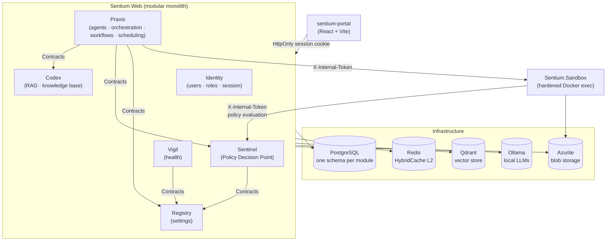

# Sentium

> A self-hostable, security-first platform for building, orchestrating and governing autonomous AI agents - powered entirely by local LLMs.

Sentium is a multi-agent platform built on **.NET 10** - a modular monolith orchestrated by **Aspire** - and a **React** front-end. It lets you create AI agents, compose them into multi-agent workflows, give them tools (code execution, knowledge retrieval, scheduling, memory), and run the whole thing **on your own hardware** against **local models served by Ollama** - no data ever leaves the machine.

What sets Sentium apart is that every agent action is **mediated by a security control plane**: a dedicated Policy Decision Point (Sentinel) authorizes each tool call, a hardened Docker sandbox isolates all code execution, and a continuous self-improvement loop lets agents learn from past runs.

---

## Table of contents

- [Key features](#key-features)
- [Architecture](#architecture)
- [Technology stack](#technology-stack)
- [Getting started](#getting-started)
- [Running the tests](#running-the-tests)
- [Security model](#security-model)
- [Repository layout](#repository-layout)

---

## Key features

| Capability                               | Description                                                                                                                                                                               |
| ---------------------------------------- | ----------------------------------------------------------------------------------------------------------------------------------------------------------------------------------------- |
| **Conversational assistant**             | A streaming (SSE) chat assistant with tool use, live "thinking" traces, and human-in-the-loop approval for high-risk tool calls.                                                          |
| **Custom agents**                        | Define your own agents (name, persona/instructions, model) and manage them through the portal.                                                                                            |
| **Multi-agent orchestration**            | An Orchestrator agent decomposes a goal, assembles a squad of specialist agents, runs them sequentially, then a Validator agent reviews and triggers self-correcting re-runs.             |
| **Visual workflow builder**              | Compose reusable, ordered multi-agent workflows; run them on demand and replay every run from a persisted log.                                                                            |
| **Retrieval-Augmented Generation (RAG)** | Document ingestion (chunk → embed → store in Qdrant) across three vector collections: knowledge base, agent learnings, and user memories (the Codex module).                              |
| **Self-improvement loop**                | Agents capture reusable learnings that are automatically, semantically recalled and injected into future runs.                                                                            |
| **Isolated code execution**              | Agents can run Python / Node.js in a heavily hardened, network-disabled Docker sandbox; output artifacts are harvested to blob storage.                                                   |
| **Skills**                               | Built-in skills plus user-defined and uploaded-Markdown skills, unlocked on demand via a `load_skill` mechanism.                                                                          |
| **Autonomous scheduling**                | Agents (or users) can schedule recurring background jobs (Quartz cron) that execute code through the sandbox.                                                                             |
| **Workspaces & files**                   | Upload files into workspaces; they are asynchronously vectorized and made available to agents as context.                                                                                 |
| **Security control plane (Sentinel)**    | Every tool call passes a Policy Decision Point that performs rate-limiting and an LLM-based semantic-intent / prompt-injection check, with a fail-closed posture and full forensic audit. |
| **Health monitoring (Vigil)**            | Continuous probing of every module, the sandbox and the infrastructure, incident tracking, and a live status stream.                                                                      |
| **Knowledge map**                        | An interactive, animated visualization of the vector store and semantic search traversal.                                                                                                 |
| **Centralized configuration (Registry)** | Per-user and global runtime settings with a two-tier cache and cluster-wide invalidation.                                                                                                 |
| **Identity & access**                    | ASP.NET Core Identity with cookie-based session authentication, a two-tier role model (Member / Sovereign), and per-user data isolation.                                                  |

---

## Architecture

Sentium runs as two .NET processes. **Sentium.Web** is a modular monolith: it hosts every module in one process and serves the portal's API and login session. **Sentium.Sandbox** is a small, separate service that runs agent-written code in throwaway Docker containers. It stays out of the web process on purpose, because it owns the Docker socket. For local development, .NET Aspire starts both, the React portal, and the backing infrastructure.



> **Detailed diagrams.** Per-feature sequence diagrams and component and domain class diagrams live in [docs/diagrams/](docs/diagrams/). They predate the modular-monolith migration: they still show the old service names (AgentRuntime, Watchdog, Gateway) and the HTTP hops between services, which are now in-process calls.

### Modules

| Module       | Responsibility                                                                                                                                                                                        |
| ------------ | ----------------------------------------------------------------------------------------------------------------------------------------------------------------------------------------------------- |
| **Identity** | ASP.NET Core Identity: users, roles, profile and registration, plus the session endpoints the portal uses (`/bff/user`, `/bff/login`, `/bff/logout`). The browser only ever holds an HttpOnly cookie. |
| **Praxis**   | The core engine: agents, the streaming assistant, conversations, multi-agent orchestration, workflows, learnings, skills, tools, workspaces, the Quartz scheduler, and the sandbox execution history. |
| **Codex**    | The knowledge base: embeddings, the Qdrant vector store, document ingestion and the knowledge map. Other modules push their content (learnings, memories, workspace files) through it.                |
| **Sentinel** | The Policy Decision Point (PDP). Every agent tool call and sandbox execution is authorized through a defence-in-depth policy stack, with forensic auditing and a fail-closed default.                 |
| **Registry** | Centralized, key-based runtime settings with per-user and global scopes, two-tier caching and in-process invalidation.                                                                                |
| **Vigil**    | Probes every module, the sandbox and each infrastructure dependency, raises and resolves incidents, and streams live health over SSE.                                                                 |

**Sentium.Sandbox** is stateless: it has no database and no user-facing API. It accepts only `POST /execute` from Sentium.Web, asks Sentinel to authorize each run, executes the code in a hardened container and uploads any output artifacts to blob storage. Praxis records every run, including denied ones, and serves the history at `/api/sandbox/*`.

### Module layout

Every module is one class library under `src/modules/<Module>`:

```
Contracts/                    → the only surface other modules may use (interfaces + DTOs)
Features/<Feature>/           → the module's features (services, repositories, workers)
Controllers/  Dtos/  Validation/  Entities/
Data/                         → <Module>DbContext + migrations (the module's own schema)
<Module>ModuleExtensions.cs   → DI registration, migrations on startup, endpoint mapping
<Module>Routes.cs             → the module's route prefix (api/<module>)
```

Modules reference each other only through `Contracts`; a unit test (`ModuleBoundaryTests`) fails the build if one module uses another module's internals.

### Cross-cutting patterns

- **Authentication** - ASP.NET Core Identity issues an HttpOnly session cookie. There are no tokens in the browser and no token hops between modules.
- **Module boundaries** - modules call each other in-process through their `Contracts` interfaces. Facades over a module's database open their own DI scope per call, so concurrent callers never share a `DbContext`.
- **Internal service calls** - only Sentium.Web ↔ Sentium.Sandbox crosses a process boundary. Both directions are authenticated with a pre-shared `X-Internal-Token` header (the `SystemCaller` policy).
- **Per-user data isolation** - user-scoped tables carry a `UserId` and EF Core global query filters scope every query automatically; the `Sovereign` role and background tasks bypass the filter through an explicit accessor.
- **In-process background work** - no message broker. Workflow runs and file ingestion go through in-memory queues (`Channel<T>`) drained by hosted services; agent token streams fan out through an in-memory relay with replay for SSE reconnects. Sentium.Web is designed to run as a single instance.
- **Caching** via HybridCache (L1 in-process + L2 Redis); a settings change evicts every module's cached copy directly.
- **Resilience** - a global Polly pipeline (retry + timeout + circuit-breaker) is applied to all HttpClients.

---

## Technology stack

**Backend**

- .NET 10 / C# · ASP.NET Core
- .NET Aspire (orchestration & service discovery)
- `Microsoft.Extensions.AI` + `Microsoft.Agents.AI` (agent framework) over **Ollama**
- Entity Framework Core (PostgreSQL via Npgsql)
- ASP.NET Core Identity (cookie authentication)
- Redis (HybridCache) · Quartz.NET (scheduling)
- Qdrant (vector store) · Docker.DotNet (sandbox)
- FluentValidation · Polly · Serilog → OpenTelemetry

**Models (default, all local via Ollama)**

- Chat / reasoning: **Gemma** (`gemma4:e4b` by default; Qwen3 and others selectable)
- Embeddings: **embeddinggemma-2:740m** (768-dimensional)

**Frontend**

- React 19 + TypeScript + Vite (`sentium-portal`)
- TanStack Query v5 (server state) · Zustand v5 (client/streaming state)
- SCSS modules · pnpm

**Testing**

- xUnit v3 · Testcontainers · `Aspire.Hosting.Testing` (backend)
- Vitest (frontend) · Playwright (E2E)

---

## Getting started

> **Full installation guide:** [docs/installation.md](docs/installation.md) covers all three
> ways to run Sentium - **.NET Aspire** (recommended for development), **Docker Compose**
> (self-hosted deployment), and **front-end only** - with prerequisites, configuration reference,
> GPU acceleration, platform notes, and troubleshooting. The quick paths below get you started.

### Prerequisites

- **.NET 10 SDK**
- **pnpm** (11.x)
- **Docker** - required for the code-execution sandbox, Testcontainers, and the Aspire-managed infrastructure containers
- An NVIDIA GPU is recommended for usable local-LLM latency (the AppHost requests GPU support for Ollama), but not strictly required

### Run the whole system

The Aspire AppHost is the single entry point. It starts Sentium.Web, the Sandbox, the portal, and every infrastructure dependency (PostgreSQL, Redis, Qdrant, Ollama, Azurite), and automatically pulls the default Ollama models on first run.

```bash
dotnet run --project src/aspire/Sentium.AppHost/Sentium.AppHost.csproj
```

Then open the **Aspire dashboard** (the URL is printed on startup) to see every resource, its logs, and its endpoints. The **portal** is at `http://localhost:5173`; it sends you to its own `/login` page to sign in or register.

> First start takes a while: Docker images and the Ollama models are downloaded. Subsequent starts reuse the persisted data volumes.

### Run with Docker Compose

If you'd rather self-host the whole platform with plain Docker (no .NET SDK on the host), a complete [`docker-compose.yml`](docker-compose.yml) builds the Sentium.Web, Sandbox and portal images and starts all infrastructure. It wires them together with the same connection strings and service-discovery keys that Aspire injects.

**Prerequisites:** Docker (with the Compose plugin) and the .NET SDK **only** for the one-time dev-certificate step below.

```bash
# 1. Configure secrets and ports
cp .env.example .env            # then edit the secrets in .env

# 2. Generate the TLS dev certificate for Sentium.Web (the session cookie is Secure),
#    using the same password you set for CERT_PASSWORD in .env, and trust it locally:
mkdir certs            # dotnet dev-certs does not create the target directory
dotnet dev-certs https -ep certs/sentium.pfx -p <CERT_PASSWORD>
dotnet dev-certs https --trust

# 3. Build and start everything
docker compose up --build
```

Once the stack is healthy:

- **Portal and API (Sentium.Web)** - `https://localhost:8443`
- **Qdrant** - `http://localhost:6333/dashboard`

Sentium.Web applies every module's EF Core migrations automatically on first start, and a one-shot `ollama-init` container pulls the chat + embedding models into a persistent volume.

**Notes & caveats**

- **HTTPS for the session cookie.** Sentium.Web terminates TLS (step 2) so the session cookie can be issued as `Secure`. The built portal is served from the same origin, so no CORS is involved. This mirrors how the Aspire setup runs over HTTPS.
- **Code sandbox.** The Sandbox mounts the host Docker socket and a job directory that must share an identical path on host and container (`SANDBOX_JOBS_DIR`). This works on Linux/macOS and the WSL2 backend; Windows users should point it at a path inside WSL2.
- **GPU.** Local inference is slow on CPU. Uncomment the NVIDIA `deploy` block on the `ollama` service (requires the NVIDIA Container Toolkit) for GPU acceleration.

> The Aspire AppHost remains the recommended path for day-to-day development (richer dashboard, hot reload, no cert setup). Docker Compose targets self-hosted deployment.

### Front-end only (against a running Sentium.Web)

```bash
cd src/clients/sentium-portal
pnpm install
pnpm dev          # Vite dev server on :5173 (proxies /api and /bff to Sentium.Web)
pnpm lint
pnpm build        # outputs into src/hosts/Sentium.Web/wwwroot
```

### Database migrations

All modules share one PostgreSQL database (`sentiumdb`); each module owns one schema with its own migrations history. To add a migration to a module:

```bash
dotnet ef migrations add <Name> \
  --project src/modules/<Module> \
  --startup-project src/hosts/Sentium.Web \
  --context <Module>DbContext \
  --output-dir Data/Migrations
```

---

## Running the tests

**Backend (xUnit v3)**

```bash
dotnet test                                                            # everything
dotnet test tests/Sentium.Tests.Unit/Sentium.Tests.Unit.csproj        # unit
dotnet test tests/Sentium.Tests.Integration/...                       # integration (needs Docker: PostgreSQL + Redis Testcontainers)
```

**Frontend (Vitest)**

```bash
cd src/clients/sentium-portal
pnpm test:run
pnpm test:coverage
```

**End-to-end (Playwright)** - boots the full Aspire stack (`--TestRun=true`) in a dedicated Testing mode with a throwaway database (`sentiumdb_e2e`) and seeded baseline data:

```bash
cd e2e
pnpm test          # headless
pnpm test:ui       # visual mode
```

---

## Deployment & trust model

Sentium is designed to be **self-hosted** - typically by a single operator on a single host (or a single private network), with all AI inference running locally via Ollama. This deployment model is what justifies several of the security choices below, so it is worth making the trust boundary explicit:

- **Sentium.Web is the only public surface.** The browser talks exclusively to it over an `HttpOnly` session cookie. The Sandbox and the infrastructure run on the internal/orchestrated network and are not intended to be exposed to the public internet.
- **Inside that boundary, Sentium.Web and the Sandbox authenticate to each other with a pre-shared internal token** (`X-Internal-Token`, the `SystemCaller` policy). For a single-operator, single-host deployment this is a right-sized, low-friction choice: there is no untrusted co-tenant on the internal network, and it avoids forcing operators to provision certificates, a PKI, or a service mesh. The internal token acts as **defense-in-depth on top of** network isolation, not as the sole control.
- **The internal token is generated per-installation as a secret** (managed as an Aspire secret parameter) - it is not a shipped default. Operators should treat it like any other deployment secret and rotate it if it is ever exposed.
- **Out of scope for the default posture:** multi-tenant hosting on a shared/hostile network, where transport-level mutual identity (mTLS) or per-service credentials between Sentium.Web and the Sandbox would be the appropriate next step.

---

## Security model

Security is a first-class concern, enforced at several layers:

1. **Authentication** - ASP.NET Core Identity in the Identity module. The browser only receives a `Secure`, `HttpOnly` session cookie and never holds a token.
2. **Authorization** - a two-tier role model (`Member`, `Sovereign`). Privileged operations (user/role management, model pull/delete, global settings, audit log) require `Sovereign`.
3. **Data isolation** - every user-scoped entity is filtered by `UserId` through EF Core global query filters; cache keys and vector searches are user-scoped.
4. **Policy Decision Point (Sentinel)** - every agent tool call is authorized before execution. The policy stack performs sliding-window rate limiting and an **LLM-based semantic-intent check** that compares the attempted action against the user's original prompt to catch prompt injection and agent hallucination. The engine is **fail-closed**: any error denies the action, and every decision is written to a forensic audit log.
5. **Human-in-the-loop** - high-risk tools (e.g. code execution) pause the stream and require explicit user approval before running.
6. **Sandbox isolation** - code runs in Docker containers with networking disabled, a read-only root filesystem, all Linux capabilities dropped, `no-new-privileges`, a non-root user, a seccomp profile, `noexec` tmpfs, and hard CPU / memory / PID / file-descriptor limits, plus an execution timeout.
7. **Internal API hardening** - the two cross-process endpoints (Sentinel's policy evaluation, called by the Sandbox, and the Sandbox's `execute`) require a pre-shared internal token and are never exposed to the browser.

---

## Repository layout

```
src/
  aspire/Sentium.AppHost/          # Aspire orchestration - the single entry point
  hosts/
    Sentium.Web/                   # the modular monolith host (API, session, portal static files)
    Sentium.Sandbox/               # isolated, stateless code-execution service
  modules/
    Codex/                         # RAG and the knowledge base
    Identity/                      # users, roles, session cookie
    Praxis/                        # core engine (agents, orchestration, workflows, scheduling)
    Registry/                      # centralized configuration
    Sentinel/                      # Policy Decision Point
    Vigil/                         # health monitoring
  clients/
    sentium-portal/                # React app (including the login page)
  shared/                          # Sentium.Core (constants, results), infrastructure, service defaults
tests/
  Sentium.Tests.Unit/
  Sentium.Tests.Integration/
  Sentium.Tests.AppHost/
e2e/                               # Playwright end-to-end suite
docs/                              # architecture docs & diagrams
```

---

<sub>Sentium - All AI inference runs locally; no external AI provider is required.</sub>
