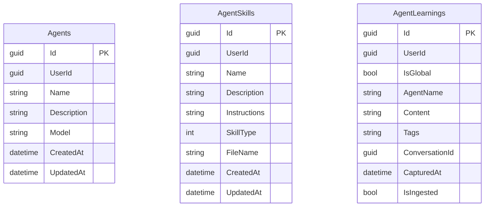
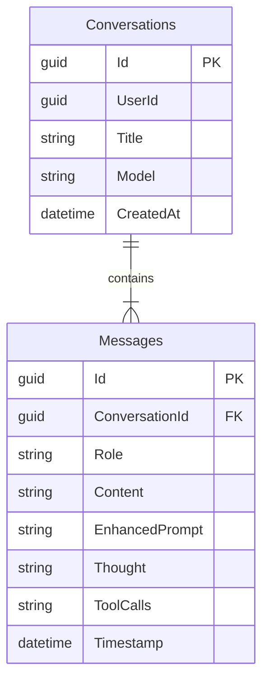
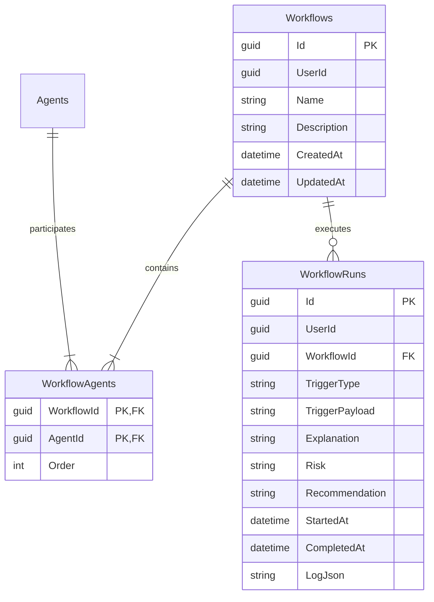
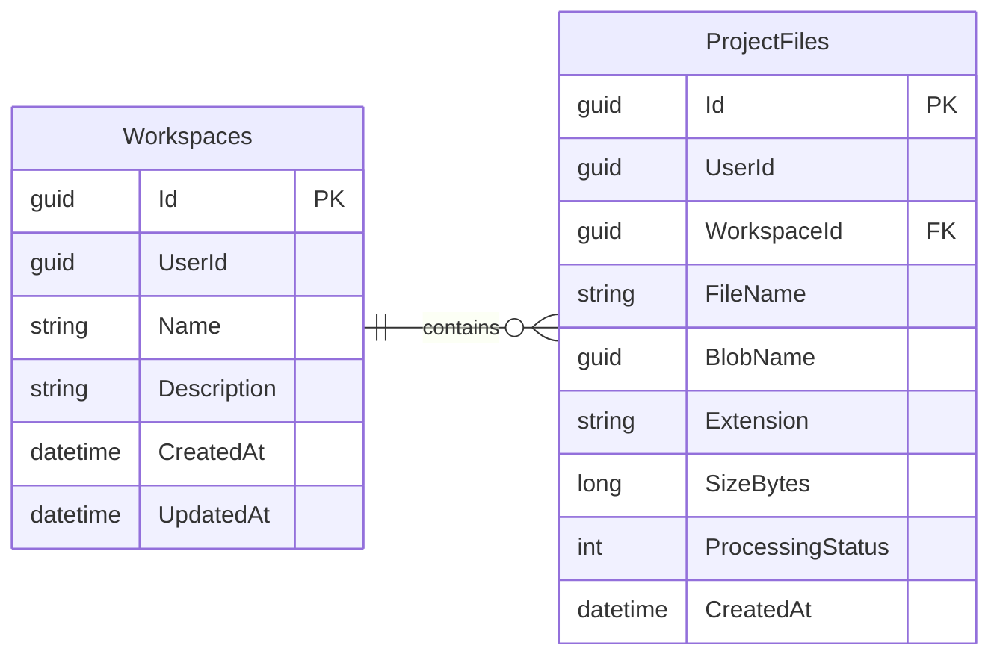
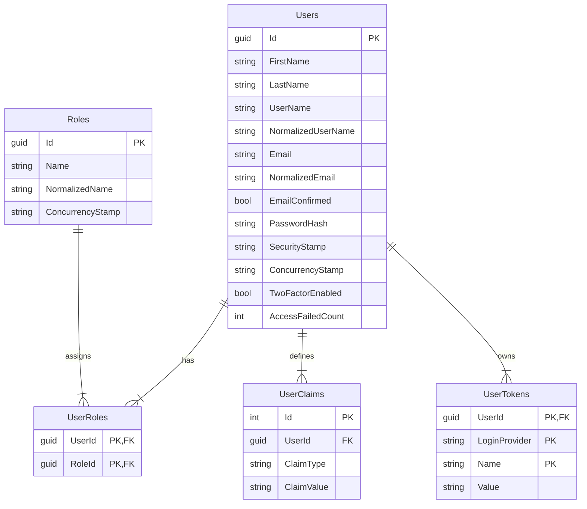
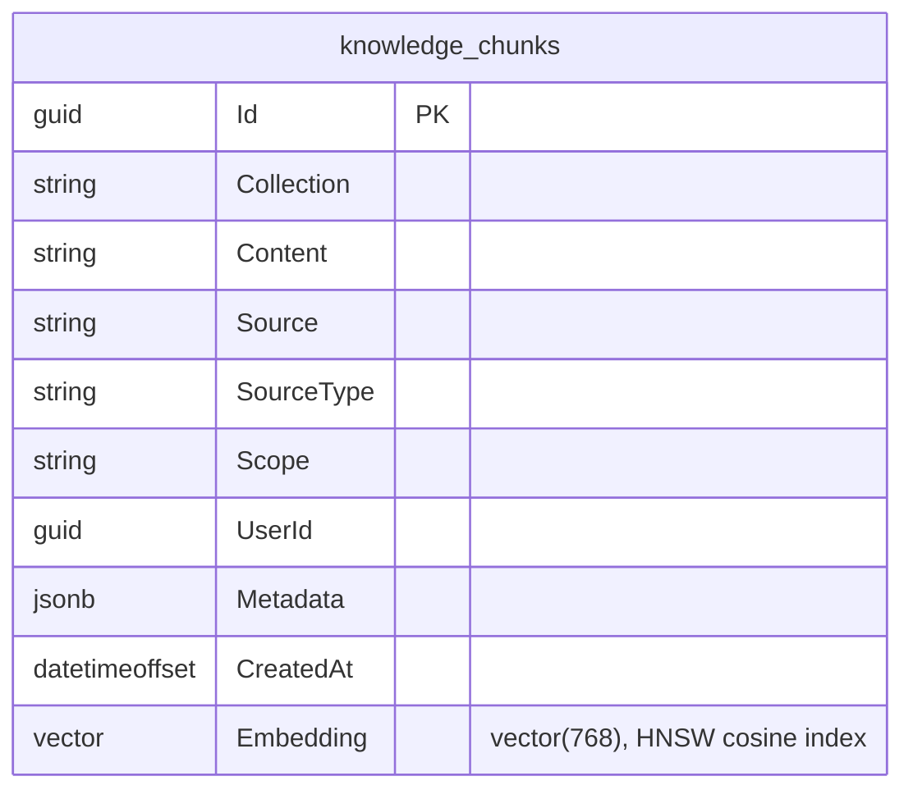
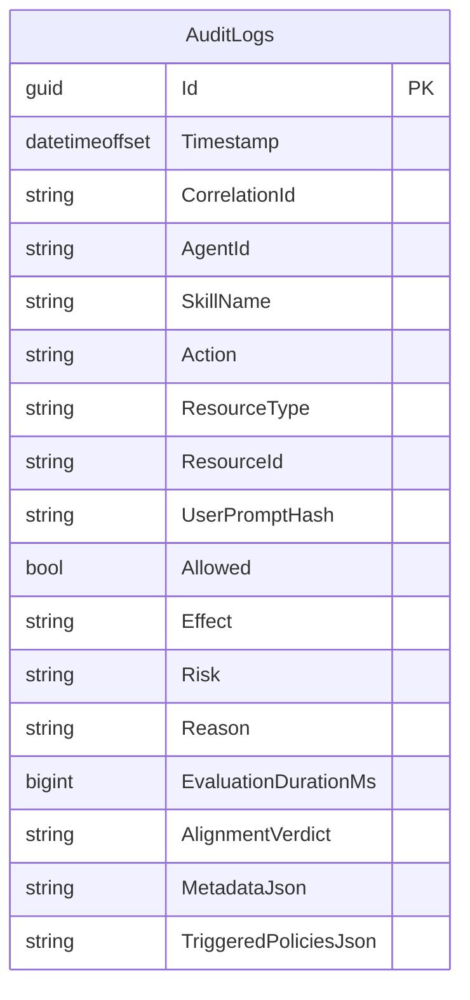
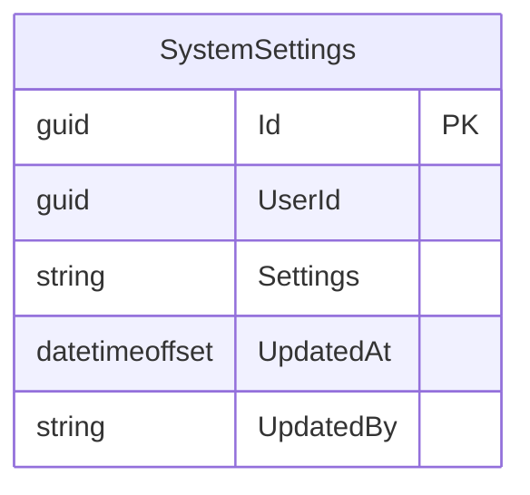
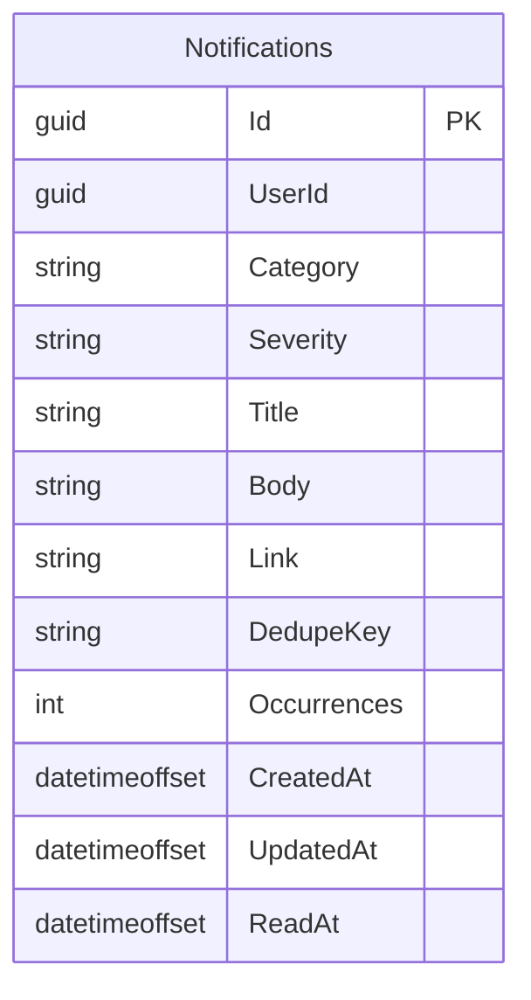
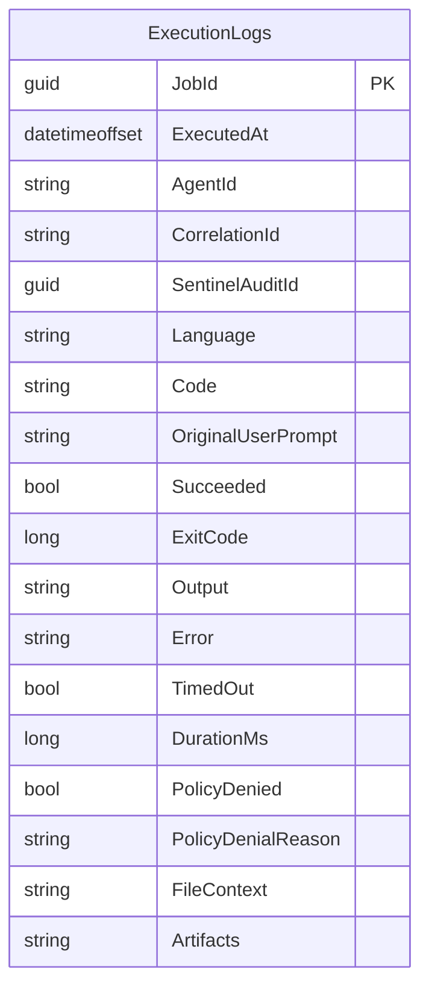

All modules share one PostgreSQL database (`sentiumdb`); each module owns one schema with its own
migrations history. Relationships never cross a schema: modules refer to each other's rows by id only.

# Agent Core & Skills Domain (`praxis` schema)

# Conversations Domain (`praxis` schema)

# Workflow Domain (`praxis` schema)

# Workspace Domain (`praxis` schema)

# Identity Domain (`identity` schema)

# Knowledge Domain (`codex` schema)

# Audit Domain (`sentinel` schema)

# Settings Domain (`registry` schema)

# Notifications Domain (`nuntius` schema)

`UserId` references an Identity user by value (no cross-schema foreign key). A partial unique index on
`(UserId, DedupeKey) WHERE ReadAt IS NULL AND DedupeKey IS NOT NULL` keeps at most one unread Notification per key.

# Execution Domain (`praxis` schema)

