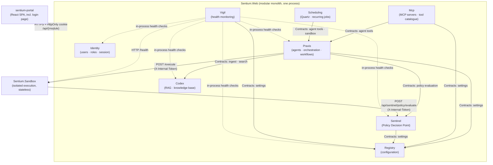

Solid arrows inside Sentium.Web are in-process calls through the target module's `Contracts`
(`ModuleBoundaryTests` rejects any other dependency). Only the two Sandbox arrows cross a process
boundary.
