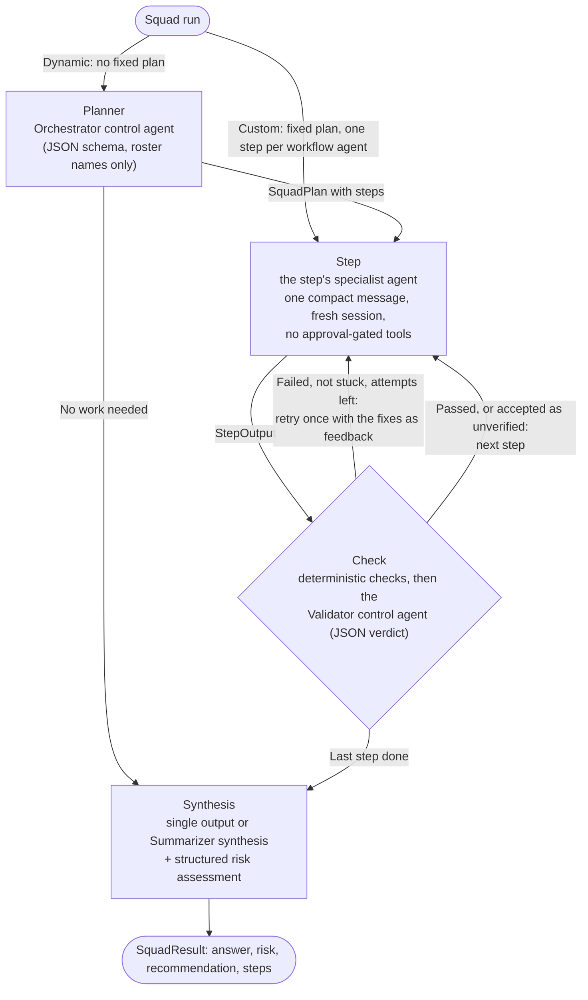

Every hand-off between executors is one immutable, typed message (`StepRequest`, `StepOutput`,
`SquadOutcome`); there is no shared transcript. Each step's progress streams to the run's
`StreamRelay` stream while it runs.
